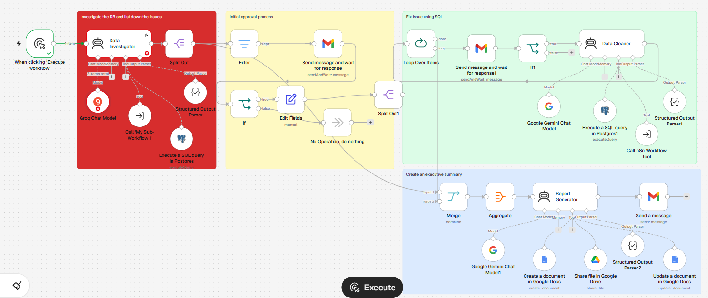

# AI-Powered Data Investigation and Reporting Agent

## Overview

This project demonstrates an AI-powered data operations workflow built in **n8n** that investigates database issues, supports data cleaning through SQL, incorporates a review and approval process, and automatically generates an executive-level report.

The workflow combines **AI agents, PostgreSQL, SQL, Google Gemini, Groq, Gmail, Google Docs, and Google Drive** to support a structured process from issue identification through investigation, resolution, and reporting.

> **Note:** This repository is a portfolio project created to demonstrate workflow automation and AI-driven data operations. It does not contain production credentials, confidential data, or proprietary business information.

---

## Business Problem

Data quality issues can require significant manual effort to investigate, validate, resolve, and communicate to stakeholders.

A typical process may involve:

- Identifying potential database issues
- Investigating data using SQL
- Reviewing findings
- Obtaining approval before remediation
- Cleaning or correcting data
- Consolidating investigation results
- Preparing management or executive reports

This project explores how **AI agents and workflow automation** can support and streamline this end-to-end process.

---

# Solution

The workflow is divided into four major stages:

1. 🔍 **Database Investigation**
2. 👤 **Initial Review and Approval**
3. 🛠️ **Data Cleaning and Issue Resolution**
4. 📊 **Executive Report Generation**

The overall process follows this flow:

```text
Identify Database Issues
          ↓
AI-Powered Investigation
          ↓
SQL Database Analysis
          ↓
Review and Approval
          ↓
AI-Assisted Data Cleaning
          ↓
SQL-Based Issue Resolution
          ↓
Aggregate Results
          ↓
Generate Executive Report
          ↓
Google Docs + Google Drive
          ↓
Email Notification
```

---

# Workflow Architecture

## 1. Database Investigation

The workflow begins with a **Data Investigator** AI agent.

The agent supports database investigation and is connected to:

- AI chat model
- PostgreSQL SQL query capabilities
- Structured output parsing
- Additional n8n workflow tools

The purpose of this stage is to investigate potential database issues and organize the findings into a structured format.

---

## 2. Initial Review and Approval

The investigation results move through a review process before data cleaning actions proceed.

This stage includes:

- Filtering investigation results
- Conditional workflow logic
- Gmail-based communication
- Response handling
- Approval routing

This introduces a **human-in-the-loop checkpoint** into the workflow.

---

## 3. Data Cleaning and Issue Resolution

Approved items move into the data cleaning process.

The workflow processes items individually and uses a **Data Cleaner AI agent** supported by:

- Google Gemini
- PostgreSQL
- SQL queries
- Conditional logic
- Structured output parsing
- Additional n8n workflows

This stage demonstrates how AI-assisted analysis can work alongside SQL-based data operations.

---

## 4. Executive Report Generation

The results from the investigation and cleaning stages are consolidated.

The workflow:

- Merges outputs from different stages
- Aggregates relevant findings
- Generates an executive-level summary using an AI agent
- Creates a report in Google Docs
- Updates and shares the report through Google Drive
- Sends a notification using Gmail

---

# Workflow Screenshot



> The workflow is organized into logical sections covering investigation, approval, issue resolution, and executive reporting.

---

# Technology Stack

| Technology | Purpose |
|---|---|
| **n8n** | Workflow orchestration and automation |
| **AI Agents** | Investigation, data cleaning, and report generation |
| **Groq Chat Model** | AI-powered investigation support |
| **Google Gemini** | AI-powered analysis and report generation |
| **PostgreSQL** | Database investigation and SQL operations |
| **SQL** | Data analysis and issue resolution |
| **Gmail** | Review, approval, and notifications |
| **Google Docs** | Executive report creation |
| **Google Drive** | Report storage and sharing |
| **Structured Output Parser** | Structuring AI-generated outputs |

---

# Key Features

### 🔍 AI-Powered Database Investigation

Uses an AI agent to support the identification and investigation of potential database issues.

### 🗄️ SQL-Based Analysis

Integrates PostgreSQL tools to investigate and work with database information using SQL.

### 👤 Human-in-the-Loop Review

Includes a review and approval stage before data cleaning actions proceed.

### 🛠️ AI-Assisted Data Cleaning

Uses an AI-powered Data Cleaner agent to support issue resolution.

### 🔄 Workflow Automation

Automates the movement of information between investigation, review, cleaning, and reporting stages.

### 📊 Executive-Level Reporting

Generates a consolidated summary designed for business and executive stakeholders.

### 📄 Automated Documentation

Creates and updates reports using Google Docs and Google Drive.

### 📧 Automated Notifications

Uses Gmail to support communication and report notifications.

---

# Architecture

For a more detailed explanation of the system architecture, see:

➡️ [Architecture Documentation](./docs/architecture.md)

The architecture separates the workflow into clear functional stages:

```text
Investigation
      ↓
Approval
      ↓
Data Cleaning
      ↓
Reporting
```

This separation improves workflow clarity and supports better control over automated data operations.

---

# Workflow Documentation

Additional documentation is available in the following files:

- 📘 [Workflow Overview](./docs/workflow-overview.md)
- 🏗️ [Architecture](./docs/architecture.md)
- 🔒 [Privacy and Security](./docs/privacy-and-security.md)
- ✅ [Validation and Testing](./docs/validation-and-testing.md)

---

# Validation and Testing

The workflow was validated by testing the major components and confirming successful data flow between workflow stages.

Validation included:

- AI agent execution
- Database investigation
- PostgreSQL query integration
- Structured output processing
- Conditional workflow routing
- Approval workflow logic
- Data cleaning workflow execution
- Result aggregation
- Report generation
- Google Docs integration
- Google Drive sharing
- Gmail communication

For additional details, see:

➡️ [Validation and Testing Documentation](./docs/validation-and-testing.md)

---

# Privacy and Security

This repository does not include:

- API keys
- Passwords
- Database credentials
- Production connection strings
- Confidential customer information
- Proprietary business data

Credentials should be managed securely using the appropriate credential management capabilities of the platforms involved.

The workflow design also includes a review and approval stage to provide additional control over data operations.

For more details, see:

➡️ [Privacy and Security Documentation](./docs/privacy-and-security.md)

---

# Skills Demonstrated

This project demonstrates practical experience with:

- **Workflow Automation**
- **n8n**
- **Agentic AI**
- **Generative AI**
- **AI Agents**
- **SQL**
- **PostgreSQL**
- **Data Investigation**
- **Data Quality**
- **Data Cleaning**
- **Conditional Workflow Logic**
- **Human-in-the-Loop Automation**
- **Google Gemini**
- **Groq**
- **Google Workspace Automation**
- **Gmail Integration**
- **Google Docs**
- **Google Drive**
- **Executive Reporting**
- **Structured Data Processing**

---

# Project Disclaimer

This project is intended as a **portfolio demonstration of AI-powered workflow automation and data operations concepts**.

The workflow structure and documentation demonstrate how AI agents can support database investigation, data cleaning, human review, and automated reporting.

No proprietary company code, confidential production data, or sensitive credentials are included in this repository.

---

## Author

**Priyanka Chouhan**

Data & Analytics Professional | SQL | BI & Analytics | Python | Workflow Automation | Agentic AI
